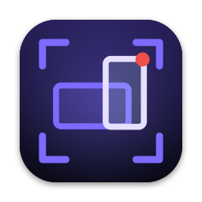
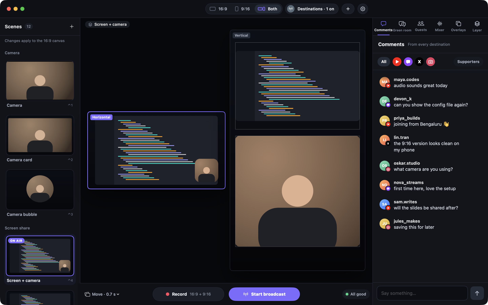
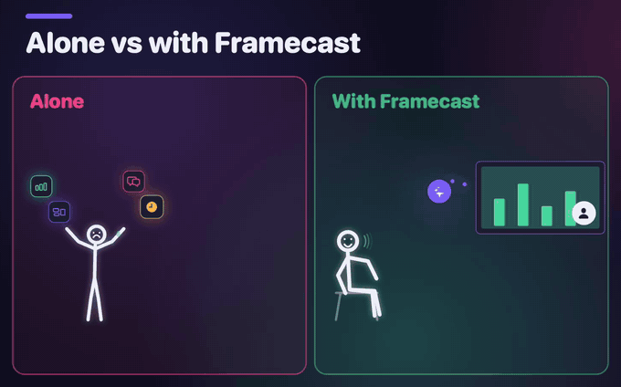
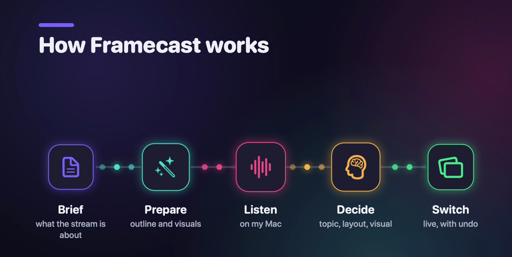
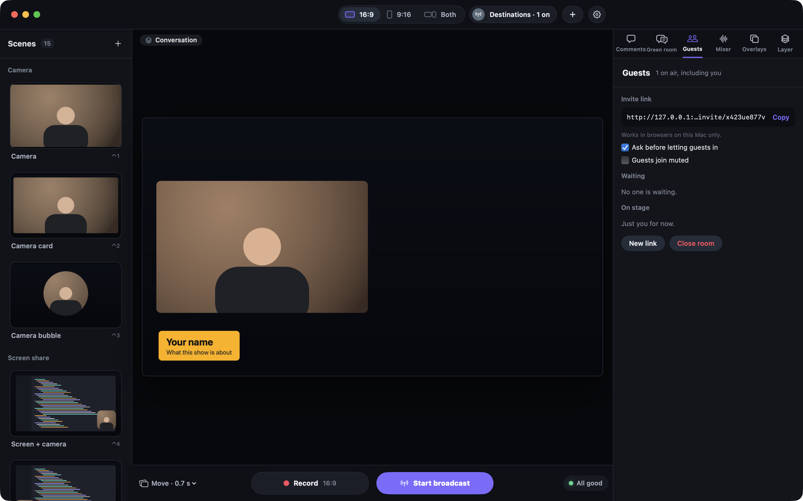
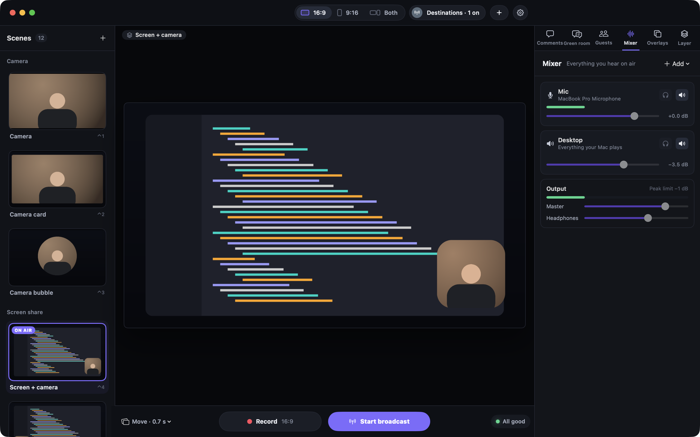
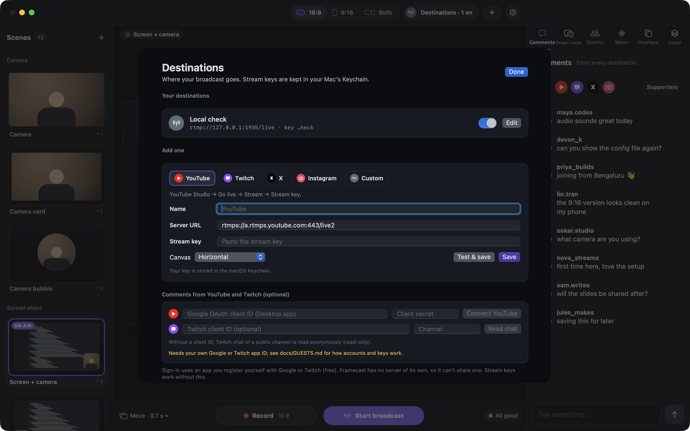
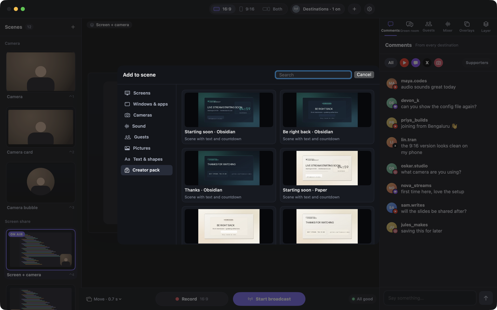

<p align="center">
  
</p>

<h1 align="center">Framecast</h1>

<p align="center">
  A free live-streaming and recording studio for the Mac, with an AI director that runs the show while you talk.
</p>

<p align="center">
  <a href="https://github.com/DhananjaySarathe/framecast-studio/releases/latest/download/Framecast.dmg"><b>Download for Mac</b></a>
  &nbsp;·&nbsp; <a href="https://dhananjaysarathe.github.io/framecast-site/"><b>Website</b></a>
</p>

<p align="center">
  macOS 14 or later (the AI director needs macOS 26) &nbsp;·&nbsp; Apple silicon and Intel &nbsp;·&nbsp; free and open source (MIT)
</p>



## What Framecast does

Going live on your own means talking while you switch layouts, put graphics up and take them down. Framecast takes
the switching off your hands.

<p align="center">
  
</p>

- **It runs the show while you talk.** Before the stream, you write a short brief and Claude (Anthropic's AI, on
  your own Claude plan) turns it into an outline and graphics. During the stream, Framecast listens on your Mac,
  works out which topic you're on and changes what viewers see: a graphic, your screen, your camera in a circle or a
  square. Topics can come in any order, and ⌃⌥⌘U, from any app, undoes the AI's last change.
- **One show, two shapes.** Every scene is drawn on a 16:9 and a 9:16 canvas at the same moment, so one show gives
  you a landscape stream for YouTube and a vertical one for Instagram, plus vertical recordings to cut into Shorts
  and Reels. Record both at once, as two files, and stream each canvas to YouTube, Twitch, X, Instagram or any
  RTMP/RTMPS server (X and Instagram allow streaming software only on some accounts).
- **Your screen share moves like an edit.** Click on your shared screen and the stream glides in to where you
  clicked, follows your cursor, and goes back to the whole screen when you stop. On 9:16 the screen fills the frame
  as a slice that follows you. It's off until you switch it on, and never magnifies password fields or apps you
  keep private ([docs/LIVE-EDITOR.md](docs/LIVE-EDITOR.md)).
- **A full studio when you want the controls.** Scenes and layouts, 60 backgrounds, name tags and other overlays,
  guests who join from a browser link, YouTube and Twitch comments on screen (with your own free OAuth app), video
  and music files, a sound pad, markers that turn into a YouTube chapter list, and clips of the last 30 seconds in
  both shapes.
- **Your notes stay off the stream.** Framecast leaves the presenter view (your topics and points) and the Rundown
  tab out of what it captures, and asks macOS to keep them out of other apps' screen shares too.
- **It runs on your Mac.** No Framecast account, subscription, analytics or update checks. The AI director is
  optional and uses your own Claude plan and API key. Framecast only connects where you point it: your stream
  destinations and, if you turn them on, the AI on your key, guests from anywhere, YouTube or Twitch chat and the
  upload speed test ([details](#privacy-and-security)).

## How a live show works



1. **Brief.** Open the **Rundown** tab in the right-hand panel, click **New show** and describe the stream: the
   topics, what you want people to take away, a few lines you might say. Not a script.
2. **Prepare.** Click **Copy for Claude** and paste it into Claude Desktop, or click **Claude Code** and paste the
   command into Terminal. (Once, first: turn on the control link in Settings › AI and add Framecast to Claude; that
   page shows the text to copy.) On your Claude plan, Claude writes the outline, topics with three to six points
   each, and has Framecast draw graphics from data in its own style: motion graphics (roadmaps, checklists, bar
   charts, gauges, step-by-step pipelines, stick-figure scenes), title, list and quote cards, and reference
   pictures. Everything is saved in the show's folder.
3. **Listen.** Go live and turn on **Listen**. Apple's speech recognition turns what you say into text, on your Mac.
   For Hinglish, choose **Hinglish (English + Hindi)** in Settings › AI.
4. **Decide.** About every 6 seconds while you talk, a fast model on your own API key (Claude Haiku 5.5 or OpenAI's
   gpt-6-luna) gets the outline, your scene and graphic names, what's on air and the last 90 seconds of what you
   said, as text. It works out which topic you're on and whether to change one thing: put a graphic up, take it
   down, or change the layout. At list prices that's about $0.10–0.50 per hour of show (an estimate).
5. **Switch.** In **Auto**, Framecast makes the change. In **Suggest**, it shows the change for 12 seconds and you
   take it with ⌃⌥⌘T. Either way ⌃⌥⌘U puts the last change back. In Auto, switching a scene yourself or undoing
   pauses the AI for 30 seconds.

The presenter view (toolbar › **Presenter**) shows your topics and ticks off points as you cover them. Prefer a
script? Rundown also turns a written script into parts with cue lines (**Split by paragraphs**, or **Write it for
me** with your own key), suggests or makes the switch when you say each cue, and has a prompter and a rehearsal
mode. More in [docs/RUNDOWN.md](docs/RUNDOWN.md).

## Download and install

1. Download **[Framecast.dmg](https://github.com/DhananjaySarathe/framecast-studio/releases/latest/download/Framecast.dmg)**. Every version and its notes are on
   [Releases](https://github.com/DhananjaySarathe/framecast-studio/releases).
2. Open it and drag Framecast onto Applications.
3. The first time you open Framecast, macOS says it can't verify the app, because it isn't notarized with a paid
   Apple Developer ID. Allow it once:
   - macOS 15 or later: try to open it once, then open System Settings › Privacy & Security, scroll down to
     Security and click **Open Anyway** next to Framecast. Confirm with your password or Touch ID, then click
     **Open**.
   - macOS 14: Control-click Framecast in Applications, choose **Open**, then click **Open**.
4. Framecast asks for the camera, microphone and screen recording the first time it needs them. After you allow
   Screen Recording, quit and reopen it.

**What you need.** macOS 14 (Sonoma) or later. Following your voice (**Listen**) needs macOS 26 or later: that
covers the AI director, cue lines, the prompter following you and Rehearse. The AI director's changes on screen also
need your own Anthropic or OpenAI API key (Settings › AI); preparing a show from a brief uses Claude Desktop or
Claude Code on your Claude plan. Recording, streaming, scenes, overlays and the rest work on macOS 14 with no key.
The download is a universal app for Apple silicon and Intel; so far it has been run on Apple silicon with macOS 27.

**Guests** join from a browser link. For guests on your Wi-Fi (macOS 15 or later), install the free LiveKit server
with Homebrew (`brew install livekit`). For guests anywhere, you need your own LiveKit Cloud project and the guest
page on a static host such as Cloudflare Pages (both have free plans). See [docs/GUESTS.md](docs/GUESTS.md).
Phones join the same way as **camera angles** of you: pick one with a click or ⌃⌥⌘1–6, or let the shuffle cut
between them in your pauses, with your face kept in frame and your voice lined up with each phone's picture. See
[docs/ANGLES.md](docs/ANGLES.md).

**Live captions** (macOS 26 or later) show what you say at the bottom of both canvases as you say it, recognised on
this Mac by Apple's speech recognition: free and private. Turn them on with ⌃⌥⌘L; correct lines in the transcript,
and every recording gets an `.srt` and a transcript next to it. See [docs/CAPTIONS.md](docs/CAPTIONS.md).

## Screenshots

| Guests | Mixer |
|---|---|
|  |  |
| **Destinations** | **Creator pack** |
|  |  |

What was tested, with results and what's missing: [docs/VERIFICATION.md](docs/VERIFICATION.md) for the studio,
streaming and guests, and the end of [docs/RUNDOWN.md](docs/RUNDOWN.md) for the AI director.

## Everything in the studio

The window has three columns: **Scenes** on the left, the canvases in the middle with the control bar under them,
and the inspector on the right (Comments · Green room · Guests · Mixer · Overlays · Layer · Rundown). The toolbar switches
between the **16:9**, **9:16** or **Both** canvases and opens Destinations, Add to scene and Settings.

- **Scenes**: click a scene (⌃1–⌃9) to put it on air with the transition shown in the control bar. With
  **Preview** on (control bar, ⌥⌘P) a click puts the scene in a private preview instead; set it up, then
  **Put on air** (⌘↩ or double-click). Every edit can be undone (⌘Z) and redone (⇧⌘Z). Edit layers on
  the canvas (drag, corner-resize, snapping) or in the Layer tab (position, crop, fit, shape, opacity, mirror,
  filters, colour, camera LUT). Right-click a scene to rename, duplicate, restore or delete it; **+** adds a new one.
- **Record**: records the canvases shown in the toolbar. Files go to `~/Movies/Framecast` by default
  (Settings › Recording) as `Framecast 2026-10-19 14.03.22 16x9.mov` (MOV, MP4 or MKV).
- **Broadcast**: add destinations in **Destinations** (⌘2): YouTube, Twitch, X, Instagram or a custom RTMP/RTMPS
  server, each with a stream key (kept in the Keychain) and a canvas. **Start broadcast** sends to every
  switched-on destination; "Also record on this Mac" records at the same time.
- **Overlays**: name tags, headlines, thank-you cards and QR codes animate over every scene (⌥⌘1–9).
- **Video and music**: Add to scene › Video or music… Videos play while their scene is on air; music loops in
  the mix and can lower itself while someone talks. The Mixer has a sound pad (⌃⌥1–9) with six built-in
  sounds and three for your own.
- **During a show**: Marker (⌥⌘M) and Clip (⌥⌘S) in the control bar. Markers and scene changes become a
  YouTube chapter list in the recap and in `<recording> chapters.txt`; Clip saves the last 30 seconds as
  16:9 and 9:16 MP4s.
- **Pre-flight check** (⇧⌘K, or in Start a broadcast): sound in the stream, mic level, cameras, permissions,
  destinations and disk space, plus an optional 10-second test recording and upload speed test.
- **Backgrounds**: Layer tab › Change background… (or ⇧⌘B) opens a picker with all 60 backgrounds (gradients,
  aurora, abstract, textures, rooms, nature, neon, basic), Dark/Light filters and large 16:9 and 9:16 previews. Add your own with `scripts/add_backgrounds.swift`
  ([docs/BACKGROUNDS.md](docs/BACKGROUNDS.md), which also has a prompt for generating them).
- **Creator pack**: Add to scene › Creator pack. Card scenes (intro with a live countdown, break, outro; four
  styles), frame scenes (camera, screen or guest placed in each opening), 20 backgrounds and 9 annotations.
  Every piece has its own 16:9 and 9:16 artwork. Countdowns restart from the Layer tab.
- **Comments**: click a comment to show it on screen. YouTube/Twitch connections need your own OAuth apps (see
  [docs/VERIFICATION.md](docs/VERIFICATION.md)).
- **Camera moves** (Settings › Live editor): **Off** (the default), **Rehearse** (moves only while you're not
  live) or **On**. A click zooms the screen share (Subtle 1.4x, Moderate 1.6x or Lively 2x, never past what stays
  sharp) and the view follows the cursor; after a quiet spell (5 s by default) it goes back to the whole screen.
  ⌃⌥⌘Z zooms to the cursor, ⌃⌥⌘X goes back to the whole screen for 30 s, ⌃⌥⌘C turns moves on or off. No zoom
  while a password field is active, on the menu bar or Dock, or into apps on the never-zoom list. The Rundown tab
  shows the frame time and the budget tier, which steps moves down if the Mac gets busy or hot. Details:
  [docs/LIVE-EDITOR.md](docs/LIVE-EDITOR.md); the research and plan: [docs/LIVE-EDITOR-PLAN.md](docs/LIVE-EDITOR-PLAN.md).
- **Show from a brief**: the AI director from [How a live show works](#how-a-live-show-works). Write the brief in
  Rundown › New show; Claude saves the outline, motion graphics, cards and reference pictures in the show's folder.
  Details: [docs/RUNDOWN.md](docs/RUNDOWN.md).
- **Rundown**: plan a show from a rough script. **Write it for me** (your own Claude or OpenAI API key, Settings ›
  AI) or **Split by paragraphs** (no AI) turns it into parts, each with a scene and the words that start it.
  **Listen** follows your voice on this Mac and, when you say the next part's cue, suggests the switch (take it
  with ⌃⌥⌘T from any app) or makes it in Auto (⌃⌥⌘U switches back). Settings › AI also has a **control link**
  so Claude Desktop, Claude Code or other MCP apps on this Mac can switch scenes and write the rundown.
  **Prompter** shows the script in large type that follows you (said words dim, cue lines highlighted, mirror
  for teleprompter glass). **Rehearse** a run-through, then see which cues were caught; a missed one shows what
  you said instead, with one click to accept it, and likely mishearings ("opa" for "opus") get a Fix button.
  Details: [docs/RUNDOWN.md](docs/RUNDOWN.md).
- **Guests**: choose who can join (this Mac, your Wi-Fi, or anyone through your own LiveKit Cloud project), open
  the guest room in the Guests tab, send the invite link, let people in, then **Put on air** in the
  Conversation, Panel or Screen with guests scenes. Guests only need a browser. Set-up: [docs/GUESTS.md](docs/GUESTS.md).

## Privacy and security

Framecast has no account, no server of its own, no analytics and no update checks. It only connects where you
point it:

| What | Goes to | Who sees your IP address |
|---|---|---|
| Streaming | the RTMP/RTMPS servers you add (YouTube, Twitch, …) | that platform |
| Chat connections (optional) | Google / Twitch APIs, with OAuth apps you register | that platform |
| Guests: This Mac | nothing leaves the Mac; every listener is on 127.0.0.1 | nobody |
| Guests: Wi-Fi | devices on your network; listeners only on the Mac's private address | devices on your Wi-Fi |
| Guests: anywhere | your LiveKit Cloud project; guests load the page from your static host | LiveKit (not your guests) |
| Upload speed test (only when you click it) | 8 MB of random data to speed.cloudflare.com | Cloudflare |
| Write it for me (only when you click it) | the script, show title and scene names to Anthropic or OpenAI, with your own API key | that service |
| AI director (while Listen is on, in Suggest or Auto) | the outline, scene and graphic names, what's on air and the last 90 s of what you said, as text, at most every 6 s, with your own API key | that service |
| Listen (speech to text) | nothing leaves the Mac: Apple's on-device speech recognition | nobody |
| Control link (off by default) | nothing leaves the Mac: 127.0.0.1 only, token required | nobody |

- Stream keys, AI API keys, the LiveKit API secret and the optional Google client secret are kept in the macOS
  Keychain.
  Sign-in tokens stay in memory only. LiveKit Cloud settings come from your own `.env` (see `.env.example`),
  which git ignores.
- Invite links for remote guests carry a short-lived token that can only ask to join; you let each person in.
  Each link works for one person. The token sits after `#`, which browsers never send to the web host.
- The guest page servers answer only requests addressed to them (127.0.0.1 or the Mac's Wi-Fi address), so web
  pages can't reach them through look-alike addresses (DNS rebinding). Wi-Fi mode refuses to open if the Mac has
  a public address.
- `FRAMECAST_UI` and its `test-control` mode exist for automated tests: they let local scripts press buttons.
  Don't set them for normal use.

## Build from source

### Requirements

- macOS 14 or later on Apple silicon.
- Xcode Command Line Tools (Swift 6.x). Full Xcode is not needed.
- Optional, free and open source, via Homebrew:
  - `brew install livekit` for guests (Framecast starts it on 127.0.0.1 when you open the guest room).
  - `brew install mediamtx` to test streaming against a local RTMP server.
  - `brew install ffmpeg` for the verification scripts.

### Build and run

```bash
./scripts/build_app.sh
```

```bash
open build/Framecast.app
```

`build_app.sh` builds with SwiftPM in release mode for this Mac's chip (the downloadable app is a universal build), assembles `build/Framecast.app` (Info.plist with usage
descriptions, generated icon, embedded `LiveKitWebRTC.framework`, guest web page) and signs it.

Signing: by default the app is signed ad hoc. macOS then forgets camera, microphone and screen permissions after
every rebuild. To keep them, create a local self-signed identity once (stored in `build/signing`, nothing is added
to your login keychain or trust settings):

```bash
./scripts/make_signing_identity.sh
```

The first launch shows onboarding (permissions, devices, format, destinations). macOS asks for Camera, Microphone
and Screen Recording access when a source first needs it. If macOS keeps asking for Screen Recording although
Framecast is switched on in System Settings, clear its old entries and allow again on the next launch:

```bash
tccutil reset All app.framecast.studio
```

## Command-line verification

`fcverify` drives the engine headlessly with a test pattern that flashes on every whole second and a tone that
beeps on the same seconds, so sync can be measured without cameras or permissions.

```bash
swift build --product fcverify
```

```bash
.build/debug/fcverify record --seconds 10 --container mkv --out local-output/verify --name t
```

```bash
python3 -I scripts/avsync.py --summary local-output/verify/t-horizontal.mkv local-output/verify/t-vertical.mkv
```

```bash
.build/debug/fcverify stream --url rtmp://127.0.0.1:1935/live --key test --seconds 15
```

```bash
.build/debug/fcverify filters
```

`scripts/mediamtx-local.yml` runs a local RTMP server with every listener on 127.0.0.1
(`mediamtx scripts/mediamtx-local.yml`).

The packaged app also accepts test hooks through `FRAMECAST_UI` (for example
`open --env FRAMECAST_UI="onboarded,test-control,mask-devices" build/Framecast.app`) and, when launched with
`test-control`, takes commands from `build/fcctl` (built from `scripts/fcctl.swift`): `record-start`,
`record-stop`, `golive`, `endstream`, `admit-all`, `stage-all`, `layout:N`, `dump-state:/path.json` and more.
They let scripts drive the app without granting Accessibility permission for UI automation, and they are off unless requested.

## Layout

```
Sources/FramecastEngine   media engine: sources, compositor, mixer, encoders, MOV/MP4/MKV, RTMP
Sources/Framecast         SwiftUI app: studio, panels, settings, destinations, chat, guests
Sources/fcverify          headless verification harness
Resources/guest           guest web page (+ vendored livekit-client, Apache-2.0)
Resources/AssetPacks      creator asset pack (manifest, artwork, previews, editable SVGs) and background library
scripts/                  build, signing, sync analysis, local servers, guest page export
docs/                     verification record, guest set-up, backgrounds, screenshots
local-output/             test recordings and captures (git-ignored)
```

Framecast's code, icon and artwork are its own. The guest page bundles livekit-client (Apache-2.0; licence in
Resources/guest), and the app uses the LiveKit Swift SDK (Apache-2.0) through Swift Package Manager.

## License

MIT; see [LICENSE](LICENSE). The LiveKit parts named above keep their Apache-2.0 license.
